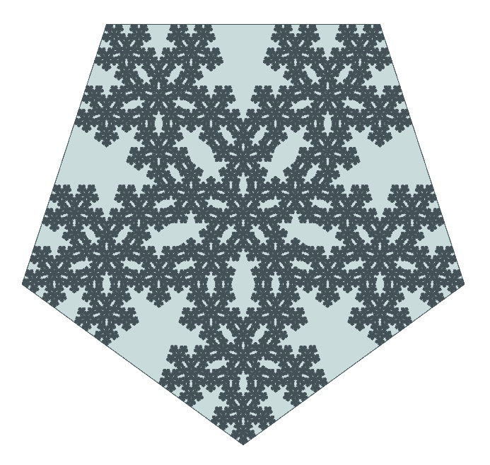

# The Pentagon Snowflake



A fivefold-symmetric, self-similar pattern generated from **one regular pentagon** by repeatedly reflecting the whole construction across the five sides of its enclosing pentagon.

The idea arose during an informal investigation of Roman bronze dodecahedra. We wondered what pattern a pentagonal face might leave if rolled across each edge onto a sheet of dough. Five reflections of the starting pentagon produce the six-pentagon cluster shown below, with triangular gaps. The enclosing outline is another regular pentagon, so the operation can be repeated on *the entire previous pattern*. By the seventh iteration, the result resembles a particularly unruly snowflake.

The Roman pastry-tool idea was just a hypothesis, **not an archaeological identification**. The geometry, though, stands on its own.

## Construction

1. Begin with a regular pentagon of unit side length (generation 0).
2. Keep the existing pattern in place and reflect a copy across each of the **five edges of its outer pentagon**.
3. Those six copies fit within a new, larger regular pentagon. The uncovered triangular spaces remain.
4. Repeat from step 2, using the **new outline** and reflecting the *complete existing pattern*, rather than only one little pentagon.

The operation is an idealized geometric reflection, not a simulation of a physical dodecahedron maintaining contact with a table.

## Mathematics

Let `φ = (1 + √5)/2` be the golden ratio. The enclosing pentagon is rotated by 180° and enlarged in edge length by

```text
s = φ² = (3 + √5)/2 ≈ 2.61803398875
```

at every generation. Thus, starting from a unit pentagon, generation `N` has:

- `6^N` copies of the original small pentagon;
- outer side length `φ^(2N)`;
- a filled-area fraction `(6/φ^4)^N` inside its enclosing pentagon.

When the outer pentagon is normalized to the same size at every generation, the nested construction approaches a self-similar limiting set. Since the six copies have disjoint interiors, its similarity (and Hausdorff) dimension is

```text
D = log(6) / log(φ²) ≈ 1.8617159595
```

The enclosing boundary remains a plain pentagon; the increasingly intricate structure is in its interior.

| Generation | Small pentagons | Outer scale |
| ---: | ---: | ---: |
| 0 | 1 | 1× |
| 1 | 6 | 2.618× |
| 2 | 36 | 6.854× |
| 3 | 216 | 17.944× |
| 4 | 1,296 | 46.979× |
| 5 | 7,776 | 122.992× |
| 6 | 46,656 | 321.997× |
| 7 | 279,936 | 842.999× |

## Generate your own

Requires Python 3.9+; standard-library-only for SVG output.

```sh
python3 pentagon_roll.py 7 -o snowflake.png
```

To generate every stage through generation 4:

```sh
python3 pentagon_roll.py 4 --frames
```

For a raster PNG as well, install CairoSVG (Debian package `python3-cairosvg`):

```sh
python3 pentagon_roll.py 4 --png --size 1400 -o example.svg
```

**Rendering note:** The generator uses nested `<use>` elements to keep its SVG output compact, but browsers and SVG rasterizers can struggle at high generations. The repository therefore includes the generation-7 **PNG** rather than the huge recursive SVG.

## Files

- [`pentagon_roll.py`](pentagon_roll.py) — Python generator (SVG; optional PNG).
- [`snowflake.png`](snowflake.png) — generation 7 bitmap artwork.
- [`test_pentagon_roll.py`](test_pentagon_roll.py) — standard-library unit tests.

## Credits

- **Concept and geometric construction:** **enki** ([devoid-of-void](https://github.com/devoid-of-void)), who proposed recursively rolling a pentagon across each edge.
- **Python implementation, mathematical write-up, and SVG generator:** **ChatGPT (OpenAI, GPT-6)**, known in the conversation as *isimud*, working with enki.
- **Artwork:** computer-generated from that construction using the included program.

Created in November 2026, starting with a Roman dodecahedron, a hypothetical pastry tool, and an unexpected encounter with the golden ratio.
